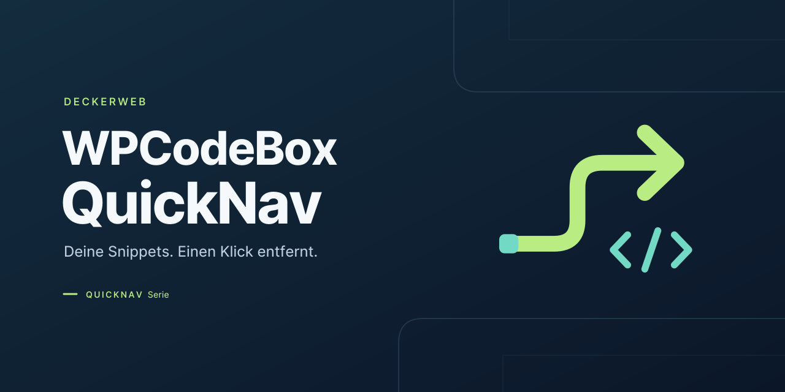
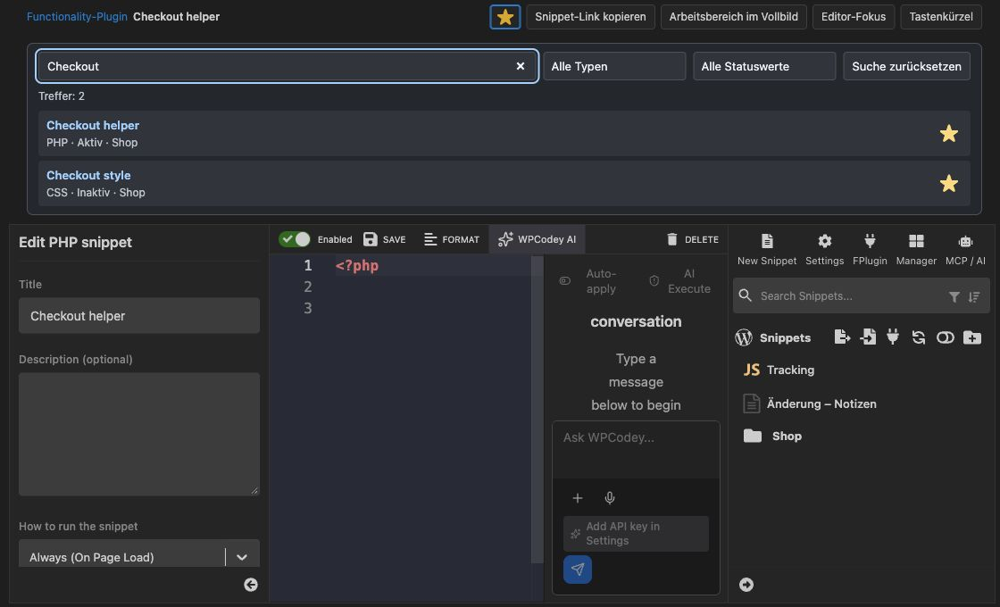

# WPCodeBox QuickNav

Deine Snippets. Einen Klick entfernt. WPCodeBox QuickNav verbindet die WordPress-Toolbar mit Favoriten, Snippet-Suche, praktischen Editoransichten und einer Übersicht über das WPCodeBox-Functionality-Plugin.

[Plugin-Website](https://deckerwebplugins.com/de/plugins/wpcodebox-quicknav/)

**1.0.1 · WordPress 6.9+ · PHP 8.3+ · WPCodeBox 2 ≥ 1.4.1**

[English](README.md) · [Vollständige Anleitung und Fragen nach Themen](https://github.com/deckerweb/wpcodebox-quicknav/wiki/Anleitung)

## Inhalt

- [Auf einen Blick](#part-1)
- [Installation und Einstieg](#part-2)
- [Hauptfunktionen](#part-3)
- [FAQ](#part-4)
- [Änderungsverlauf](#part-5)
- [Über dieses Plugin](#part-6)

## Auf einen Blick

- Persönliche Favoriten
- Snippets in allen Ordnern finden
- Toolbar und Menü
- Vollbild und Editor-Fokus
- Functionality-Plugin-Übersicht
- Befehle, abgesicherter Modus und Ressourcen

## Installation und Einstieg

Voraussetzungen: WordPress 6.9 oder neuer und PHP 8.3 oder neuer. Für die Snippet-Navigation und die Editoransichten muss WPCodeBox 2 ab Version 1.4.1 aktiv sein. Die frühere WPCodeBox-Version V1 wird nicht unterstützt. WPCodeBox wird separat erworben und ist nicht enthalten. Das Add-on bleibt ohne WPCodeBox aktivierbar; Einstellungen und die eigenständige Functionality-Plugin-Übersicht bleiben verfügbar. Das ZIP unter Plugins → Plugin hinzufügen → Plugin hochladen installieren. Bei einem Update das Ersetzen der vorhandenen QuickNav-Version bestätigen. Favoriten und Anzeigeoptionen bleiben erhalten.

Bei aktivem WPCodeBox-Hauptmenü: WPCodeBox 2 → Snippets, QuickNav-Einstellungen oder Functionality-Plugin. Liegt WPCodeBox unter Werkzeuge oder ist es inaktiv, befinden sich beide QuickNav-Seiten unter Einstellungen. Alte QuickNav-Einstellungslesezeichen werden zur passenden Menüposition weitergeleitet. Für die Übersicht im jeweils aktuellen Menü navigieren.

## Hauptfunktionen

*QuickNav-Suche direkt im WPCodeBox-Editor. WPCodeBox QuickNav 1.0.0 · Snippet Workspace (Demo).*

### Persönliche Favoriten

Bis zu 100 Snippets als Favoriten auswählen oder den Stern eines Suchtreffers verwenden. Die Auswahl gehört zum Benutzerkonto auf der aktuellen Website. Vorschaukarten öffnen den jeweiligen Editor.

### Snippets in allen Ordnern finden

Die kompakte QuickNav-Suche durchsucht Titel und Ordnerpfade, kombiniert Typ und Aktivierungsstatus und zeigt bis zu 50 Treffer samt Gesamtzahl. Sie ist standardmäßig aktiv und in den QuickNav-Einstellungen abschaltbar. Die native WPCodeBox-Suche und der Manager bleiben verfügbar.

### Toolbar und Menü

Direktzugriff auf Favoriten, aktive und inaktive Snippets, Ordner, Einstellungen und den Functionality-Plugin-Status. Das erste Untermenü von WPCodeBox heißt „Snippets“. QuickNav-Einstellungen und Functionality-Plugin-Übersicht liegen darunter; ohne WPCodeBox-Hauptmenü unter WordPress-Einstellungen. Der Name des Toolbar-Haupteintrags ist persönlich pro Website einstellbar. Der Admin-Hauptmenüname ist optional für die Website einstellbar. Typ und gespeicherter Status haben eigene lesbare Labels in der Toolbar.

### Vollbild und Editor-Fokus

„Arbeitsbereich im Vollbild“ blendet WordPress-Menü und Toolbar aus. „Editor-Fokus“ blendet zusätzlich die Snippet-Liste, die Snippet-Einstellungen und die QuickNav-Suche aus. Die native Speicherleiste bleibt sichtbar. Zurück-Schalter und Escape beenden die Ansicht, ohne den Editor neu zu laden. Titel und Typ des geöffneten Snippets bleiben oben sichtbar. Ein Stern speichert das lokale Snippet direkt als persönlichen Favoriten. Vollbild und Editor-Fokus lassen sich mit persönlichen Tastenkürzeln umschalten. Eine kompakte Hilfe im Editor zeigt QuickNav- und native Kürzel. Optional wird die letzte Ansicht persönlich pro Website gemerkt. Die Hilfe bietet direkte Ansichtsaktionen; gespeicherte lokale Snippets erhalten einen kopierbaren Editor-Link. Die Bereiche passen sich an die verbleibende Fensterhöhe an.

### Functionality-Plugin-Übersicht

Die eigenständige Übersicht zeigt erkannte verwaltete Plugins mit echtem WordPress-Aktivierungsstatus, konfigurierten Snippet-Einbindungen und Dateistatus. Bei verfügbarem WPCodeBox werden Titel, Typ und Ordner zugeordnet und datiert gespeichert. Bei deaktiviertem WPCodeBox bleiben Dateiliste und gespeicherte Zusatzinformationen erreichbar. Betriebsstatus und Zähler fassen die Lage zusammen. Suche und Filter grenzen die Liste ein; fehlende Dateien stehen zuerst. Dateipfade lassen sich kopieren und Informationen gezielt aktualisieren.

### Befehle, abgesicherter Modus und Ressourcen

Die native WordPress-Befehlspalette erhält dort, wo sie verfügbar ist, QuickNav-Verknüpfungen. Die Toolbar bietet den WPCodeBox-Safe-Mode-Zugang, optionale Ressourcen und passende Entwicklerwerkzeuge. Library 1.3.0 und Updater 2.4.0 sind enthalten. Ein eigenständiger roter Warnstreifen mit Flamme rechts bleibt bei aktivem Safe Mode sichtbar, auch im Frontend.

## FAQ

### Welche WPCodeBox-Version wird unterstützt?

Die Anbindung unterstützt ausschließlich WPCodeBox 2 ab Version 1.4.1. WPCodeBox V1 wird nicht unterstützt. Bei deaktiviertem WPCodeBox 2 bleiben Einstellungen und Functionality-Plugin-Übersicht verfügbar. Bei erkanntem Functionality-Plugin bleibt auch die QuickNav-Toolbar erreichbar. Einzelne Snippets werden weiterhin in WPCodeBox verwaltet; direkte Editorlinks erscheinen nur bei verfügbarer Anbindung.

### Wie beende ich Vollbild und Fokus?

Oben „Zurück zur normalen Ansicht“ wählen oder Escape drücken. Wenn ein Dialog oder eine Editor-Vervollständigung geöffnet ist, zuerst diesen schließen. Die Ansichten sind vorübergehend und starten nach einem Seitenaufruf wieder normal. Browser-Vollbild wird nicht eingeschaltet.

### Was wird gespeichert?

Favoriten und Anzeigeoptionen pro Benutzer und Website sowie datierte Functionality-Plugin-Metadaten pro Website. Kein Snippet-Quellcode und keine Ausführungsprotokolle. Deaktivierung und Deinstallation erhalten diese Daten und sämtliche WPCodeBox-Daten. Temporäre Updatedaten werden bereinigt; die Library berücksichtigt andere installierte Hosts.

### Welche externen Verbindungen gibt es?

Der Updater kann öffentliche stabile GitHub-Releases prüfen. Automatische Updates werden nicht eingeschaltet. Der optionale Online-Katalog der Library ist standardmäßig aus. Übertragen werden übliche HTTP-/WordPress-/PHP-Metadaten, kein Snippet-Code und keine Favoriten. Ressourcenlinks kontaktieren ihr Ziel beim Öffnen.

### Was gilt für Multisite?

Favoriten, Anzeigeoptionen und Metadatenstände bleiben je Website getrennt. Die Übersicht unterscheidet Website- und Netzwerkaktivierung. Sie ist in der Website-Verwaltung erreichbar; es gibt keine netzwerkweite Snippet-Sammlung. Netzwerkaktivierte Plugins können nur in der Netzwerkverwaltung deaktiviert werden.

### Verändert QuickNav erzeugte Plugins?

Nein. QuickNav liest die Konfiguration und führt dafür keine Plugin-Datei aus. Zum Pausieren des gesamten Functionality-Plugins führt „Plugins verwalten“ zur nativen WordPress-Verwaltung. Die WPCodeBox-interne Abschaltfunktion kann das erzeugte Plugin entfernen; für ein einfaches Pausieren die normale WordPress-Deaktivierung verwenden.

### Functionality-Plugin: Was bedeuten „aktiv“ und „Einbindung freigegeben“?

Diese Angaben gehören zur QuickNav-Übersicht des von WPCodeBox erzeugten Functionality-Plugins. Sie zeigen die Konfiguration, nicht die tatsächlich ausgeführten Snippets. „Plugin aktiv“ bedeutet: Das Functionality-Plugin ist in WordPress aktiviert. „Einbindung freigegeben“ bedeutet: Das Snippet ist in der erzeugten Hauptdatei zum Laden vorgesehen; sein Ladeeintrag ist nicht auskommentiert. Ob der Snippet-Code tatsächlich ausgeführt wird, hängt zusätzlich zum Beispiel von Bedingungen, Hooks und dem abgesicherten Modus (Safe Mode) ab. Auch Fehler können die Ausführung verhindern. Beispiel: Ein Snippet, das nur im Frontend laufen soll, muss bei einem Aufruf im Admin nicht ausgeführt werden, obwohl seine Einbindung freigegeben ist. QuickNav zeichnet keine tatsächlichen Ausführungen auf.

[Alle Fragen nach Themen](https://github.com/deckerweb/wpcodebox-quicknav/wiki/Fragen-nach-Themen)

## Änderungsverlauf

## 1.0.1 · 2026-11-09

- **Behoben:** deckerweb Library auf 1.3.0 und Updater auf 2.4.0 aktualisiert: normale Updates unabhängig vom Katalog, begrenzte Downloads und strengere Paketprüfung.

## 1.0.0

- **Neu:** Schnellzugriff auf WPCodeBox-2-Snippets über Favoriten, Statuslisten, Ordner und ordnerübergreifende Suche.
- **Neu:** Vollbild-Arbeitsbereich, Editor-Fokus, anpassbare Tastenkürzel und kompakte Tastenkürzelhilfe.
- **Neu:** Eigenständige Functionality-Plugin-Übersicht mit verständlichen Einbindungszuständen und gespeicherten Metadaten.
- **Neu:** Dauerhafter roter Safe-Mode-Warnstreifen mit Flamme in der Toolbar im Admin und Frontend.
- **Verbessert:** An die Fensterhöhe angepasste Editorbereiche, persönliche Beschriftung und optional gemerkte Editoransicht.

## Über dieses Plugin

WPCodeBox QuickNav ist ein unabhängiges Add-on von David Decker – DECKERWEB für Administratoren und Snippet-Autoren. Es entstand aus dem Wunsch nach denselben kurzen Wegen wie in Advanced Scripts QuickNav: Snippets über die Toolbar erreichen, Favoriten persönlich verwalten und im Editor Platz gewinnen. Dazu kommt eine verständliche Betriebsübersicht für das separat erzeugte Functionality-Plugin. WPCodeBox selbst wird weder ersetzt noch mitgeliefert.

[Downloads & Releases](https://github.com/deckerweb/wpcodebox-quicknav/releases) · [Wiki](https://github.com/deckerweb/wpcodebox-quicknav/wiki) · [Discussions](https://github.com/deckerweb/wpcodebox-quicknav/discussions)

[Credits](docs/credits.txt) · [Security](SECURITY-de.md) · [DECKERWEB](https://deckerwebplugins.com/) · [Ko-fi](https://ko-fi.com/deckerweb)

© 2026 David Decker – DECKERWEB. Plugin-Lizenz: GPL v2 oder höher.
