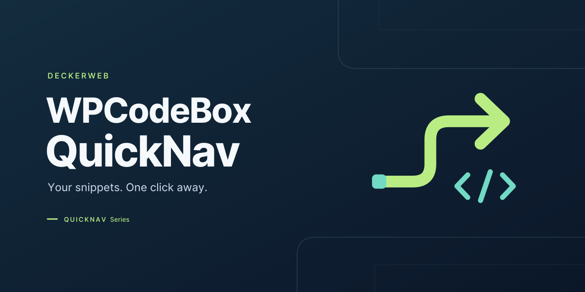
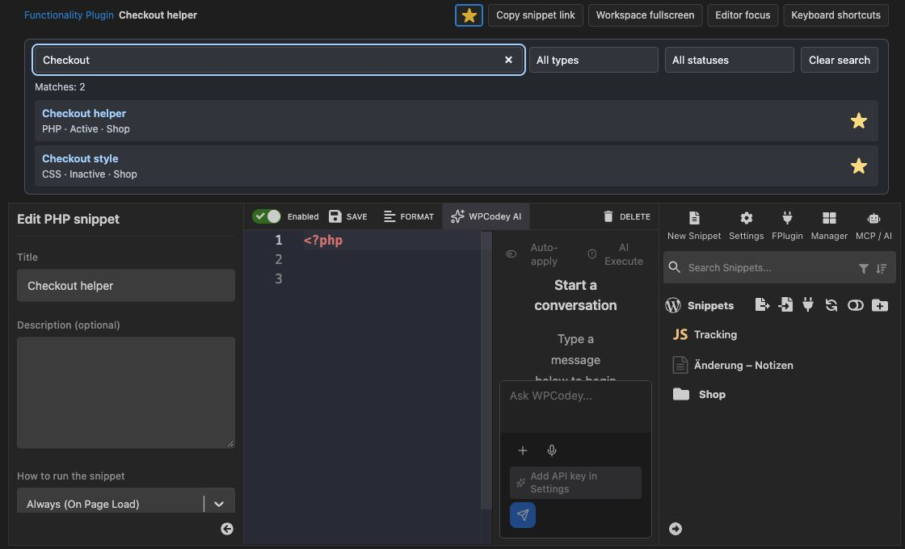

# WPCodeBox QuickNav

Your snippets. One click away. WPCodeBox QuickNav connects the WordPress toolbar to favorites, snippet search, useful editor views and an overview of the WPCodeBox Functionality Plugin.

**1.0.0 · WordPress 6.9+ · PHP 8.3+ · WPCodeBox 2 ≥ 1.4.1**

[Deutsch](README-de.md) · [Complete guide and FAQ by topic](https://github.com/deckerweb/wpcodebox-quicknav/wiki/User-guide)

## Contents

- [At a glance](#part-1)
- [Installation and getting started](#part-2)
- [Features](#part-3)
- [FAQ](#part-4)
- [Changelog](#part-5)
- [About this plugin](#part-6)

## At a glance

- Personal favorites
- Find snippets across folders
- Toolbar and menu
- Fullscreen and editor focus
- Functionality Plugin overview
- Commands, Safe Mode and resources

## Installation and getting started

Requires WordPress 6.9 or newer and PHP 8.3 or newer. Snippet navigation and workspace views require active WPCodeBox 2 version 1.4.1 or newer. The earlier WPCodeBox V1 is not supported. WPCodeBox is purchased separately and is not included. The add-on can remain active without WPCodeBox; settings and the independent Functionality Plugin overview remain available. Install the ZIP under Plugins → Add Plugin → Upload Plugin. For an update, confirm replacement of the existing QuickNav version. Favorites and display preferences are retained.

With the WPCodeBox top-level menu enabled, use WPCodeBox 2 → Snippets, QuickNav settings or Functionality Plugin. If WPCodeBox lives under Tools or is inactive, both QuickNav pages appear under Settings. Existing QuickNav settings bookmarks redirect to the appropriate menu location. Use the current menu entry for the overview.

## Features

*QuickNav search inside the WPCodeBox editor. WPCodeBox QuickNav 1.0.0 · Snippet Workspace (Demo).*

### Personal favorites

Select up to 100 snippets as favorites or use a search-result star. Favorites belong to the current user on the current website. Preview cards open the corresponding editor.

### Find snippets across folders

Compact QuickNav search matches titles and folder paths, combines type and activation filters and shows up to 50 results with the total count. Enabled by default, it can be disabled in QuickNav settings. Native WPCodeBox search and Manager remain available.

### Toolbar and menu

Direct access to favorites, active and inactive snippets, folders, settings and Functionality Plugin status. The first WPCodeBox submenu is labeled Snippets. QuickNav settings and the Functionality Plugin overview sit below it, falling back to WordPress Settings when the WPCodeBox top-level menu is unavailable. The main toolbar entry name is configurable per user and website. The admin main menu name is optionally configurable for the website. Type and saved status have separate readable toolbar labels.

### Fullscreen and editor focus

Workspace fullscreen hides the WordPress menu and toolbar. Editor focus also hides the snippet list, snippet settings and QuickNav search. The native save toolbar stays visible. Use the return button or Escape to leave without reloading the editor. The open snippet title and type stay visible at the top. A star saves the local snippet directly as a personal favorite. Fullscreen and editor focus can be toggled with personal keyboard shortcuts. Compact help in the editor shows QuickNav and native shortcuts. Optionally remember the last view personally per website. Help offers direct view actions; saved local snippets have a copyable editor link. Panels fit the remaining window height.

### Functionality Plugin overview

The independent overview lists recognized managed plugins with actual WordPress activation status, configured snippet includes and file readability. When WPCodeBox is available, matching titles, types and folders are captured in a dated snapshot. File inventory and saved metadata remain accessible when WPCodeBox is inactive. Operating status and counters summarize the situation. Search and filters narrow the list; missing files appear first. Copy file paths and explicitly refresh information.

### Commands, Safe Mode and resources

The native WordPress Command Palette receives QuickNav navigation commands where available. The toolbar offers WPCodeBox Safe Mode access, optional resources and relevant developer tools. Library 1.2.0 and Updater 2.3.0 are included. A separate red warning with flame on the right stays visible while Safe Mode is active, including on the frontend.

## FAQ

### Does active mean executed?

No. Plugin activation comes from WordPress. Enabled include means that a literal include_once entry exists in the generated main file. Conditions, hooks, run type, errors and Safe Mode affect execution. QuickNav does not log actual executions.

### Which WPCodeBox version is supported?

The integration supports only WPCodeBox 2 version 1.4.1 or newer. WPCodeBox V1 is not supported. With WPCodeBox 2 inactive, settings and the Functionality Plugin overview remain available. The QuickNav toolbar remains available when a managed Functionality Plugin is detected. Individual snippets are managed in WPCodeBox; direct editor links appear only when the integration is available.

### Does QuickNav modify generated plugins?

No. QuickNav reads configuration without executing plugin files for inspection. Manage plugins opens native WordPress plugin management to pause the entire Functionality Plugin. The upstream WPCodeBox disable operation can remove the generated plugin; use native WordPress deactivation for a simple pause.

### How do I leave fullscreen and focus?

Use Back to normal view at the top or press Escape. Close an open dialog or editor completion first. Views are temporary and reset on page navigation. Browser fullscreen is not enabled.

### What data is stored?

Favorites and display preferences per user and website, plus dated Functionality Plugin metadata per website. No snippet source or execution logs are stored. Deactivation and uninstall retain these records and all WPCodeBox data. Temporary update data is cleared; Library cleanup respects other installed hosts.

### What connects to external servers?

The Updater can check public stable GitHub releases. Automatic updates are not enabled. The optional Library online catalog is off by default. Requests send standard HTTP/WordPress/PHP metadata, without snippet code or favorites. Resource links contact their destination when opened.

### How does Multisite work?

Favorites, preferences and metadata snapshots remain site-specific. The overview distinguishes site and network activation. It lives in website administration; there is no network-wide snippet collection. Network-active plugins must be deactivated through Network Admin.

[Complete FAQ by topic](https://github.com/deckerweb/wpcodebox-quicknav/wiki/FAQ-by-topic)

## Changelog

## 1.0.0

- **New:** Quick access to WPCodeBox 2 snippets through favorites, status lists, folders and cross-folder search.
- **New:** Fullscreen workspace, editor focus, configurable keyboard shortcuts and compact shortcut help.
- **New:** Independent Functionality Plugin inventory with clear inclusion states and retained metadata.
- **New:** Persistent red Safe Mode warning with flame in the admin and frontend toolbar.
- **Improved:** Viewport-aware editor panels, personal naming and optional remembered workspace views.

## About this plugin

WPCodeBox QuickNav is an independent add-on by David Decker – DECKERWEB for administrators and snippet authors. Its purpose follows the short navigation paths of Advanced Scripts QuickNav: reach snippets through the toolbar, keep personal favorites and gain room in the editor. It also provides an understandable operational overview of the separately generated Functionality Plugin. It does not replace or bundle WPCodeBox.

[Downloads & Releases](https://github.com/deckerweb/wpcodebox-quicknav/releases) · [Wiki](https://github.com/deckerweb/wpcodebox-quicknav/wiki) · [Discussions](https://github.com/deckerweb/wpcodebox-quicknav/discussions)

[Credits](docs/credits.txt) · [Security](SECURITY.md) · [DECKERWEB](https://deckerwebplugins.com/) · [Ko-fi](https://ko-fi.com/deckerweb)

© 2026 David Decker – DECKERWEB. Plugin license: GPL v2 or later.
