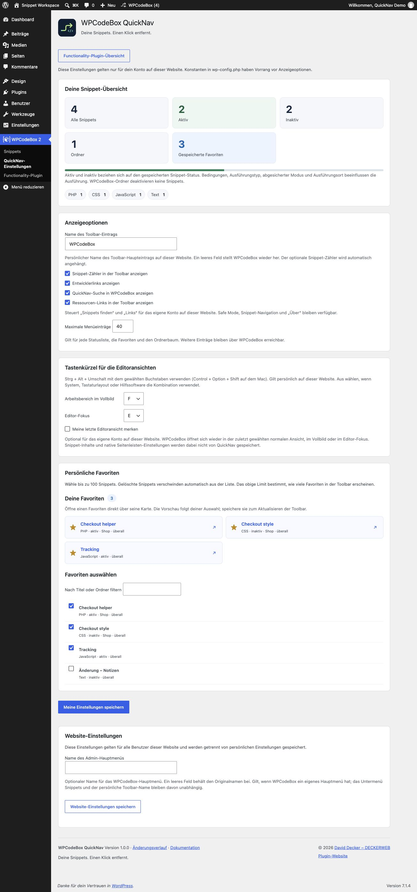
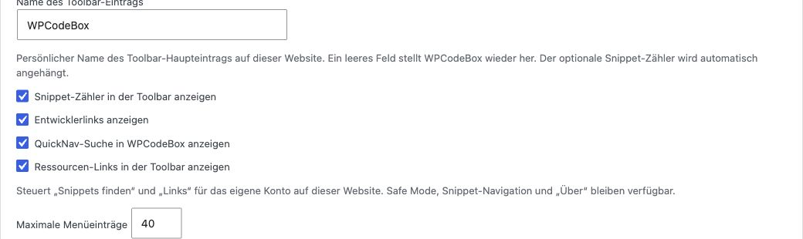
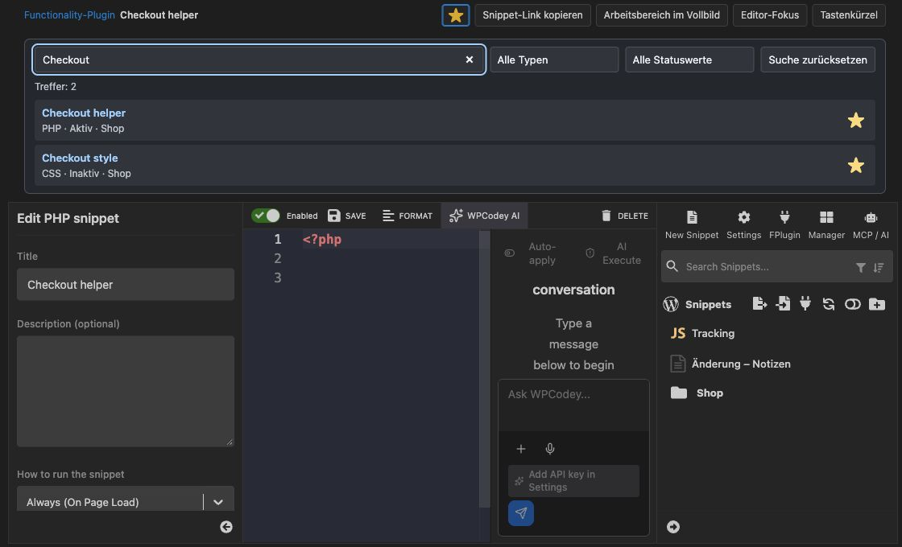
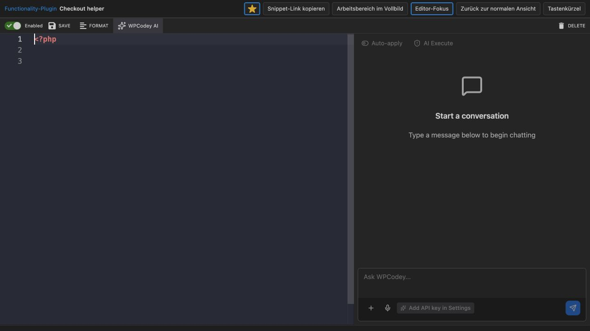
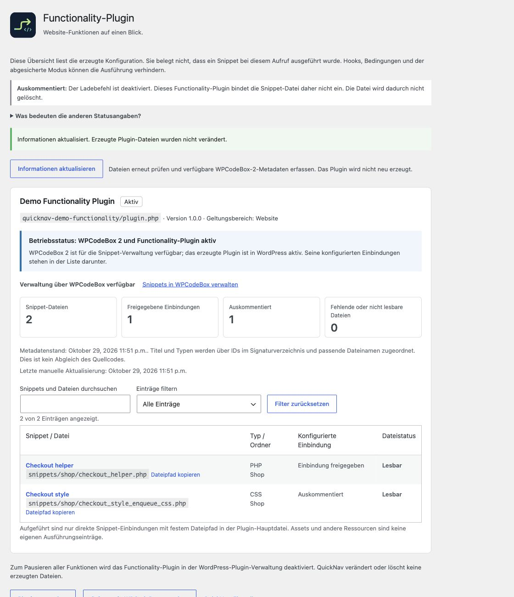

# Anleitung

[English](User-guide)

## Favoriten und Anzeigeoptionen

In den QuickNav-Einstellungen nach Titel oder Ordner filtern und höchstens 100 Snippets markieren. Die Vorschau zeigt die aktuelle Auswahl. Erst „Meine Einstellungen speichern“ übernimmt sie dauerhaft für die Toolbar. Ein Stern in einem Suchtreffer wird hingegen sofort gespeichert. Gelöschte Snippets werden nicht mehr angezeigt.

Die Eintragsgrenze gilt für jede Statusliste, die Favoriten und den Ordnerbaum: Standard 40, erlaubt 10 bis 200. Weitere Einträge bleiben in WPCodeBox erreichbar. Snippet-Zähler und Entwicklerlinks sind persönliche Anzeigeoptionen. Konstanten haben Vorrang und werden als gesperrte Felder erklärt.

Unter Anzeigeoptionen lässt sich der Name des Toolbar-Eintrags ändern. Standard ist WPCodeBox; ein leeres Feld stellt diesen Namen wieder her. Erlaubt sind bis zu 60 Zeichen als einfacher Text. Der optionale Snippet-Zähler wird separat automatisch angehängt. Diese Einstellung gilt für das eigene Konto auf der aktuellen Website.

Konstanten sind für zentrale Vorgaben und verwaltete Installationen gedacht. Für persönliche Anzeigeoptionen genügt die Einstellungsseite. Eine vorhandene WCBQN_NAME_IN_ADMINBAR-Konstante hat weiterhin Vorrang; dann wird das Namensfeld gesperrt und die Vorgabe erklärt. Der persönliche Name bleibt im Hintergrund erhalten und gilt wieder, wenn die Konstante entfernt wird. Zugriffskonstanten können die Berechtigungen weiter begrenzen.

Unter Website-Einstellungen kann der Name des Admin-Hauptmenüs geändert und separat gespeichert werden. Diese Einstellung gilt für alle Benutzer der aktuellen Website. Leer lässt den Originalnamen stehen. Sie wirkt nur, wenn WPCodeBox ein eigenes Hauptmenü hat; Snippets-Untermenü, Menüberechtigungen und persönlicher Toolbar-Name bleiben unabhängig. Der Name bleibt bei Deaktivierung und Deinstallation gespeichert.

Typ-Labels sind blau getönt; der gespeicherte Status erscheint separat grün für aktiv und grau für inaktiv. Die Schrift liegt auf einem eigenen deckenden Hintergrund und bleibt damit unabhängig vom Admin-Farbschema lesbar. Aktiv bezeichnet den gespeicherten Status und garantiert keine Ausführung: Bedingungen und Safe Mode gelten weiterhin.

Tastenkürzel für die Editoransichten werden mit den persönlichen Einstellungen gespeichert. Für beide Ansichten stehen die Buchstaben F, E, J und U sowie Aus zur Wahl. Zwei aktive Kürzel müssen unterschiedliche Buchstaben verwenden. Bestehende Favoriten, Toolbar-Name und Website-Einstellungen bleiben unabhängig.

Meine letzte Editoransicht merken ist standardmäßig ausgeschaltet. Aktiviert öffnet WPCodeBox die zuletzt gewählte normale Ansicht, Vollbildansicht oder den Editor-Fokus wieder. Gilt für das eigene Konto auf dieser Website; nicht für andere Benutzer oder Netzwerk-Websites. Das Abschalten löscht den gemerkten Ansichtsmodus. Andere persönliche Optionen, native Seitenleisten-Einstellungen und Snippet-Inhalte werden durch Ansichtswechsel nicht neu gespeichert.

Unter Anzeigeoptionen lassen sich Ressourcen-Links in der Toolbar anzeigen abschalten. Dadurch verschwinden Snippets finden und Links für das eigene Konto auf dieser Website. Standardmäßig sind die Ressourcen sichtbar. Safe Mode, Snippet-Navigation und Über bleiben verfügbar. Bestehende Konfigurationskonstanten können die jeweiligen Gruppen weiterhin ausblenden.

*Persönliche Einstellungen und Ressourcen-Links. WPCodeBox QuickNav 1.0.0 · Snippet Workspace (Demo).*

*Tastenkürzel für die Editoransichten. WPCodeBox QuickNav 1.0.0 · Snippet Workspace (Demo).*

## Suche im Alltag

Unter „Snippets“ in die QuickNav-Suche oberhalb des Editors eingeben. Alle Wörter müssen im Titel oder Ordnerpfad vorkommen; Großschreibung und Akzente werden ignoriert. Typ und Status lassen sich kombinieren. Quellcode wird nicht durchsucht. Bei vielen Treffern wird die Liste auf 50 begrenzt; präzisere Suchwörter helfen.

Ein Ordnerlink in der Toolbar öffnet die Suche für genau diesen Ordner. „Suche leeren“ hebt die Einschränkung auf. Ohne QuickNav-Suche führt der Ordnerzugang zur nativen Sammlung. Neue Snippets nutzen den nativen WPCodeBox-Dialog; ein Ordner wird nicht automatisch zugewiesen. WPCodeBox 1.4.1 verwendet flache Ordner ohne Aktivierungsstatus.

Zum Abschalten in QuickNav-Einstellungen das Feld „QuickNav-Suche in WPCodeBox anzeigen“ abwählen und speichern. Native Suche und Manager sowie die neuen Ansichtsbuttons bleiben erhalten. Die QuickNav-Suche folgt dem Hell-/Dunkelmodus von WPCodeBox.

*Snippets über Ordner hinweg finden. WPCodeBox QuickNav 1.0.0 · Snippet Workspace (Demo).*

## Vollbild und Editor-Fokus

Im WPCodeBox-Editor stehen oben „Arbeitsbereich im Vollbild“ und „Editor-Fokus“. Vollbild nutzt die verfügbare Browserfläche ohne WordPress-Menü und Toolbar; WPCodeBox-Seitenleisten bleiben sichtbar. Fokus blendet zusätzlich Snippet-Liste, Snippet-Einstellungen und QuickNav-Suche aus. Der native Editor mit Speicherleiste bleibt bestehen.

Die Ansichten ändern nur die Darstellung. Sie laden den Editor nicht neu, verändern keine Snippet-Einstellungen und speichern keinen Code automatisch. Ungespeicherte Änderungen bleiben beim Umschalten erhalten. Vor dem Verlassen der gesamten Seite weiterhin wie gewohnt speichern. Escape oder der sichtbare Zurück-Schalter beendet die Ansicht; offene Dialoge zuerst schließen.

Die WPCodeBox-eigenen Tastenkürzel bleiben verfügbar: Ctrl+1 für die Einstellungen, Ctrl+2 für die Snippet-Liste und Ctrl beziehungsweise Meta plus Backtick für beide Bereiche. Diese nativen Schalter sind unabhängig von QuickNav. Browser-Vollbild über die Betriebssystemfunktion ist eine separate Funktion.

In der oberen Leiste stehen der aktuelle Titel und Typ, auch im Fokusmodus. Titeländerungen erscheinen sofort, ohne den Code zu speichern. Der Stern ändert nur den persönlichen Favoritenstatus. Neue Snippets müssen zuerst in WPCodeBox gespeichert werden; Cloud-Snippets werden darüber nicht favorisiert. Die QuickNav-Suche kann dafür ausgeschaltet bleiben.

Standard: Strg + Alt + Umschalt + F für Vollbild und Strg + Alt + Umschalt + E für Editor-Fokus. Auf dem Mac: Control + Option + Shift mit F beziehungsweise E. Erneutes Drücken schaltet die Ansicht zurück; der Editorfokus bleibt bei Bedienung aus dem Code-Editor bestehen. Die Kürzel gelten nur auf der unterstützten WPCodeBox-Editorseite. Sie lassen sich in QuickNav-Einstellungen → Tastenkürzel für die Editoransichten persönlich pro Website ändern oder abschalten. Bei Konflikten mit Betriebssystem, Layout oder Hilfssoftware eine andere Taste beziehungsweise Aus wählen; globale Konfliktfreiheit ist nicht zugesichert.

Tastenkürzel in der QuickNav-Leiste öffnet die kompakte Hilfe mit der wirksamen persönlichen Belegung und wichtigen WPCodeBox-/Editor-Kürzeln. Die Darstellung folgt dem nativen Hell-/Dunkelmodus. Escape schließt zuerst die Hilfe, erst ein weiteres Escape verlässt die aktive QuickNav-Ansicht. Der Fokus kehrt zum Hilfe-Link zurück. Schließen und Hintergrundklick sind ebenfalls möglich. Der Einstellungslink öffnet einen neuen Tab, damit ungespeicherter Code nicht durch Navigation verloren geht. Falls das Modal nicht geöffnet werden kann, führt der Hilfe-Link zur vollständigen Editor-Referenz.

Die Hilfe enthält Speichern (Command/Strg + S), natives Formatieren (Command/Strg + B), Ausführen (Shift + F10), Snippet-Einstellungen (Control + 1), Snippet-Liste (Control + 2), beide Seitenleisten (Command/Strg + `), Codesuche (Command/Strg + F), Zeilenkommentar (Command/Strg + /) und die Editor-Befehlspalette (F1). Native Funktionen hängen vom Editor und Snippet-Kontext ab und werden von QuickNav nicht neu belegt.

Ansicht öffnen in der Tastenkürzel-Hilfe öffnet Vollbild oder Editor-Fokus direkt und schließt dabei die Hilfe. Das funktioniert auch bei abgeschaltetem Tastenkürzel. Der Rückkehr-Button bleibt sichtbar. Snippet-Link kopieren erzeugt einen direkten Link zum aktuell gespeicherten lokalen Snippet ohne temporäre Suchparameter oder Sicherheitsnachweise. Der Empfänger benötigt weiterhin passende WordPress-Berechtigungen und aktives WPCodeBox 2. Neue ungespeicherte und Cloud-Snippets haben noch keinen solchen lokalen Link. Wenn automatisches Kopieren scheitert, erscheint ein markierbares Feld zum manuellen Kopieren.

Alle Editorbereiche teilen sich die verbleibende Fensterhöhe. Listen und Einstellungsfelder scrollen intern; Save, Cancel, untere Seitenleisten-Pfeile und AI-Eingabe bleiben erreichbar. Sehr schmale Fenster erlauben internes horizontales Scrollen im Arbeitsbereich; Editor-Fokus schafft mehr Platz. Bei sehr geringer Höhe kann die AI intern scrollen. Nach einer Änderung der nativen Menüposition die WPCodeBox-Einstellungen mit Save speichern und die Seite neu laden.

*Editor-Fokus mit nativer Speicherleiste. WPCodeBox QuickNav 1.0.0 · Snippet Workspace (Demo).*

## Functionality-Plugin verstehen

WPCodeBox kann Snippets in ein eigenständiges Plugin schreiben. Dieses erzeugte Plugin kann weiter aktiv bleiben, wenn WPCodeBox deaktiviert wird. QuickNav zeigt den WordPress-Aktivierungsstatus und die direkten Snippet-Einbindungen aus dessen Hauptdatei. Ein vorhandener Ordner allein bedeutet nicht „aktiv“.

Auf der Übersicht: „Einbindung freigegeben“ bezeichnet einen direkten aktiven include_once-Eintrag; „Auskommentiert“ einen vom Generator auskommentierten Eintrag. „Lesbar“ prüft die lokale Datei, ohne sie auszuführen. „Fehlend oder nicht lesbar“ verlangt eine Prüfung der erzeugten Dateien in WPCodeBox. Ein inaktives Plugin lädt auch seine freigegebenen Einträge nicht.

Die Liste ist keine Laufzeitmessung. Sie zeigt keine garantierte erfolgreiche Ausführung und keine Fehlerfreiheit. Assets, SCSS-Teildateien und andere Ressourcen werden nicht als eigene Ausführungseinträge gezählt. Dynamische Include-Ausdrücke und separat exportierte Standalone-Plugins gehören nicht zur erkannten verwalteten Struktur.

Der Betriebsstatus unterscheidet gemeinsame Verwaltung mit aktivem WPCodeBox 2, eigenständigen Betrieb ohne verfügbares WPCodeBox 2, inaktives Functionality-Plugin und den durch WPCB_SAFE_MODE pausierten Zustand. Bei einem inaktiven Plugin gilt die Aussage nur für dessen Einbindungen, nicht für Code anderer Plugins.

Vier Zähler zeigen Snippet-Dateien, freigegebene Einbindungen, auskommentierte Einträge sowie fehlende oder nicht lesbare Dateien. Assets werden nicht mitgezählt. Fehlende freigegebene Dateien stehen ganz oben und lösen einen klaren Hinweis aus. Fehlende auskommentierte Dateien folgen danach. Dies ist eine Dateiprüfung, keine vollständige Funktions- oder Sicherheitsdiagnose.

Die Suche berücksichtigt Titel, relative Dateipfade, Typ und Ordner. Alle Suchwörter müssen passen; Großschreibung und Akzente werden ignoriert. Der Statusfilter lässt sich damit kombinieren. Die Trefferzahl bezieht sich auf die gefilterte Liste; die vier Zähler zeigen weiterhin den gesamten Bestand. Filter zurücksetzen zeigt wieder alle Einträge. Es werden keine zusätzlichen Serveranfragen ausgelöst.

Dateipfad kopieren übernimmt den relativen Pfad innerhalb des erzeugten Plugins, ohne Serververzeichnisse offenzulegen. Auf lokalem HTTP kann die Zwischenablage eingeschränkt sein. Falls automatisches Kopieren scheitert, erscheint ein markierbares Feld zum manuellen Kopieren. Ohne JavaScript bleibt der Dateipfad als normaler Text auswählbar.

Verwaltung über WPCodeBox verfügbar führt direkt zur Snippet-Verwaltung. Eigenständiger Betrieb bedeutet: Das erzeugte Functionality-Plugin ist aktiv, die unterstützte WPCodeBox-Verwaltung aber nicht verfügbar. Die Plugin-Verwaltung bleibt erreichbar; für einzelne Snippet-Änderungen ist unterstütztes aktives WPCodeBox 2 erforderlich. Auskommentiert heißt: Der Ladebefehl für die Datei ist deaktiviert; dieses Functionality-Plugin bindet sie nicht ein. Die Datei bleibt vorhanden. Einbindung freigegeben beschreibt die konfigurierte Einbindung, keine bestätigte Ausführung. Lesbar bedeutet nur, dass die Datei existiert und zugänglich ist. Bedingungen, Hooks und Safe Mode gelten weiterhin. QuickNav schaltet erzeugte Snippets nicht um.

*Konfigurierte Einbindungen und gespeicherte Metadaten. WPCodeBox QuickNav 1.0.0 · Snippet Workspace (Demo).*

## Metadaten und Betrieb ohne WPCodeBox

Die Functionality-Plugin-Übersicht einmal mit aktivem WPCodeBox öffnen. QuickNav ordnet Titel, Typ und Ordner über IDs im Signaturverzeichnis und passende eindeutige Dateinamen zu. Diese Informationen werden mit Datum als Metadatenstand je Website gespeichert. Unklare Zuordnungen bleiben beim Dateinamen.

Ist WPCodeBox später inaktiv, werden die aktuellen Einbindungen und Dateizustände weiterhin gelesen. Zusatzinformationen stammen dann aus dem gespeicherten Stand. Ändert sich die erzeugte Hauptdatei oder das Signaturverzeichnis, erscheint ein Hinweis auf möglicherweise veraltete Titel. Zum erneuten Zuordnen WPCodeBox aktivieren und die Übersicht wieder öffnen.

Der Metadatenzeitpunkt bezeichnet einen geänderten Informationsstand oder eine ausdrücklich angeforderte Aktualisierung. Ein unveränderter Stand bekommt bei normalen Seitenaufrufen kein neues Datum. QuickNav vergleicht keinen vollständigen Snippet-Quellcode und verspricht keine Synchronität zwischen Datenbank und erzeugten Dateien.

Informationen aktualisieren prüft die Übersicht erneut. Mit verfügbarem WPCodeBox 2 wird der Metadatenstand neu erfasst, auch wenn er unverändert ist. Ohne WPCodeBox 2 bleiben gespeicherte Titel und deren Erfassungsdatum erhalten; die letzte manuelle Prüfung erhält einen eigenen Zeitpunkt. Ein Hinweis auf veraltete Metadaten wird dadurch nicht entfernt. Das erzeugte Plugin wird weder neu aufgebaut noch bearbeitet und kein Snippet wird umgeschaltet.

## Verwalten, pausieren und abgesicherter Modus

Einzelne Snippets weiterhin in WPCodeBox aktivieren, deaktivieren und bearbeiten. QuickNav öffnet bei verfügbarer Anbindung den passenden Editor. Ohne WPCodeBox gibt es keine irreführenden Einzelschalter. „Plugins verwalten“ öffnet die WordPress-Pluginliste. Dort lässt sich das gesamte Functionality-Plugin regulär deaktivieren und später wieder aktivieren.

Wichtig für den Ablauf: Die interne WPCodeBox-Funktion zum Abschalten des Functionality-Plugins kann die erzeugten Plugin-Dateien entfernen. Zum reinen Pausieren die normale WordPress-Deaktivierung verwenden. QuickNav löst keine solche Löschung aus und verändert keine fremden Dateien.

WPCB_SAFE_MODE aktiviert den abgesicherten Modus schon durch seine Definition, auch bei false. Das gilt auch für das erzeugte Plugin ohne aktives WPCodeBox. Der Toolbar-Link „Safe Mode“ öffnet hingegen den WPCodeBox-Editor mit safe_mode=1 für diesen Editoraufruf. Ein solcher Link ist keine globale Pause der gesamten Website.

Links gibt es einen zustandsabhängigen Safe-Mode-Eintrag. Unabhängig davon erscheint rechts der rote Warnstreifen mit Flamme für berechtigte angemeldete Benutzer. Bei gesetzter Konstante WPCB_SAFE_MODE bleibt er im Admin und Frontend sichtbar. Nach Behebung der Fehlerursache und Entfernen der Konstante verschwindet er, sofern Safe Mode nicht noch für den aktuellen Editor-Aufruf gilt. Der Streifen verlinkt die Safe-Mode-Dokumentation und ist kein Ausschalter.

Bei eigenständigem Functionality-Plugin bleibt der rechte Warnstreifen mit gesetzter Konstante auch dann sichtbar, wenn WPCodeBox deaktiviert ist.

## Fehlerbehebung und Grenzen

Keine Übersichtseinträge: Prüfe, ob ein verwaltetes WPCodeBox-Functionality-Plugin vorhanden ist. Erkennung benötigt die Hauptdatei plugin.php, die erwartete Preconditions-Struktur, den Generatormarker und signatures.php. Umbenannte Plugin-Anzeigenamen sind möglich. Separat exportierte Plugins und manuell stark veränderte Strukturen werden nicht beliebig anhand ihres Namens erkannt.

Nur Dateinamen sichtbar: Die Titelzuordnung fehlt oder ist nicht eindeutig. WPCodeBox aktivieren, Übersicht erneut öffnen und Dateien dort prüfen. Fehlende Datei: nicht den generierten Include-Eintrag von Hand umschalten, sondern die Erzeugung und das Snippet in WPCodeBox prüfen. QuickNav repariert und überschreibt keine erzeugten Dateien.

Keine Suche oder Ansichtsbuttons: unterstützte WPCodeBox-Version, Benutzerrechte und QuickNav-Sucheinstellung prüfen. Bei einer unbekannten WPCodeBox-Oberfläche können Integrationspunkte abweichen. Ohne JavaScript bleiben native WPCodeBox-Funktionen und die serverseitige Übersicht nutzbar; Such- und Ansichtsverbesserungen benötigen JavaScript.

## Datenschutz, Datenhaltung und Multisite

Favoriten und Anzeigeoptionen pro Benutzer und Website sowie datierte Functionality-Plugin-Metadaten pro Website. Kein Snippet-Quellcode und keine Ausführungsprotokolle. Deaktivierung und Deinstallation erhalten diese Daten und sämtliche WPCodeBox-Daten. Temporäre Updatedaten werden bereinigt; die Library berücksichtigt andere installierte Hosts.

Der Updater kann öffentliche stabile GitHub-Releases prüfen. Automatische Updates werden nicht eingeschaltet. Der optionale Online-Katalog der Library ist standardmäßig aus. Übertragen werden übliche HTTP-/WordPress-/PHP-Metadaten, kein Snippet-Code und keine Favoriten. Ressourcenlinks kontaktieren ihr Ziel beim Öffnen.

Favoriten, Anzeigeoptionen und Metadatenstände bleiben je Website getrennt. Die Übersicht unterscheidet Website- und Netzwerkaktivierung. Sie ist in der Website-Verwaltung erreichbar; es gibt keine netzwerkweite Snippet-Sammlung. Netzwerkaktivierte Plugins können nur in der Netzwerkverwaltung deaktiviert werden.

Vollbild und Fokus werden nicht als dauerhafte Einstellung gespeichert. Metadatenstände enthalten nur Zuordnungsinformationen und einen Fingerabdruck der erzeugten Konfiguration; keine Zugangsdaten und keinen Snippet-Quellcode. Die normalen Frontend-Aufrufe erzeugen keine Metadatenstände und durchsuchen keine Snippet-Inhalte.

[WPCodeBox editor reference](https://docs.wpcodebox.com/editor)
