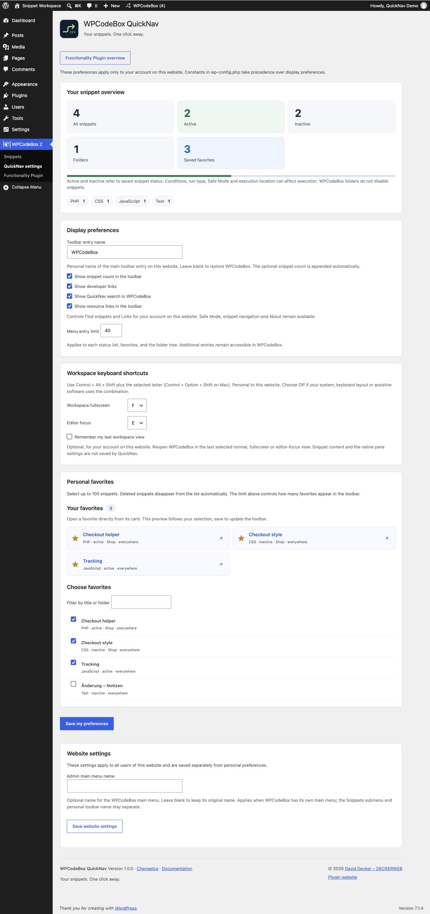
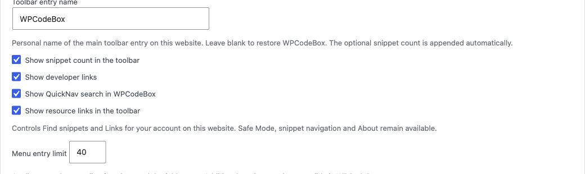
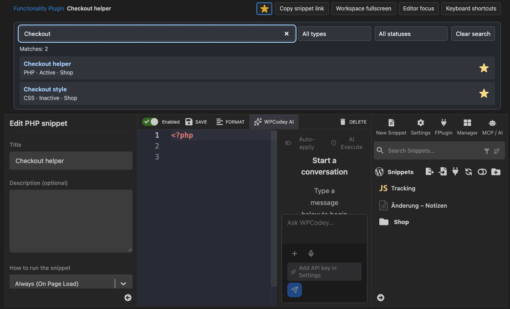
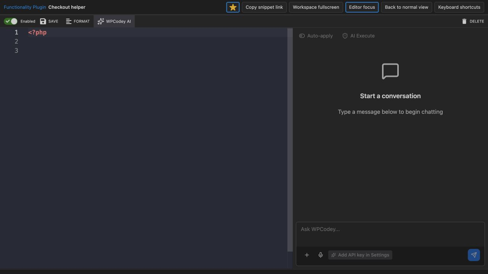
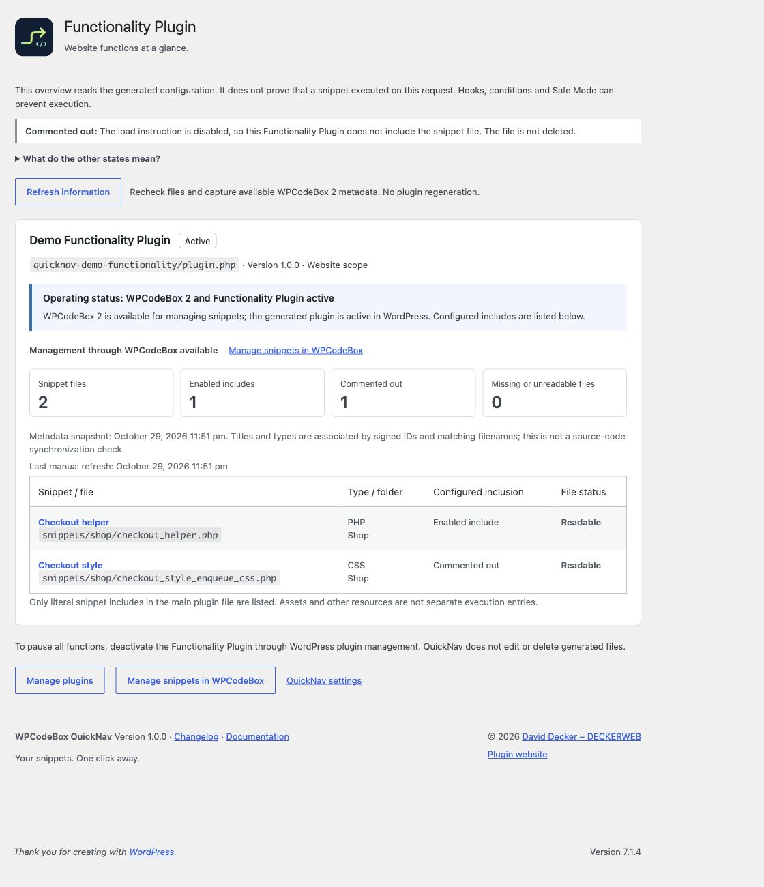

# User guide

[Deutsch](https://github.com/deckerweb/wpcodebox-quicknav/wiki/Anleitung)

## Favorites and display preferences

Open QuickNav settings, filter by title or folder and select up to 100 snippets. Preview cards follow the current selection. Save my preferences commits the selection to the toolbar. A search-result star is saved immediately. Deleted snippets no longer appear.

The entry limit applies to each status list, favorites and the folder tree: default 40, allowed range 10–200. Additional entries remain reachable in WPCodeBox. Snippet counter and developer links are personal display preferences. Constants take precedence and are shown beside locked fields.

Under Display preferences, change Toolbar entry name. The default is WPCodeBox; leave the field blank to restore it. Use up to 60 characters of plain text. The optional snippet count is appended separately. This preference belongs to your account on the current website.

Constants provide central overrides for managed installations. Use the settings page for personal display preferences. An existing WCBQN_NAME_IN_ADMINBAR constant still takes precedence; the name field is then locked and explained. Your personal name is retained and applies again when the constant is removed. Access constants may further restrict permissions.

Under Website settings, change the admin main menu name and save it separately. This setting applies to all users of the current website. Blank keeps the original name. It applies only when WPCodeBox owns a main menu; the Snippets submenu, menu permissions and personal toolbar name remain independent. The name is retained after deactivation and uninstall.

Type labels use a blue tint; saved status is shown separately in green for active and gray for inactive. Text sits on its own opaque surface, keeping contrast independent of the admin color scheme. Active describes the saved status and does not guarantee execution: conditions and Safe Mode still apply.

Workspace keyboard shortcuts are saved with personal preferences. Each view offers F, E, J and U, plus Off. Two enabled shortcuts must use different letters. Existing favorites, toolbar name and website settings remain independent.

Remember my last workspace view is off by default. When enabled, WPCodeBox reopens the last normal, fullscreen or editor-focus view. This applies to the current account on this website, separately from other users and network sites. Turning it off clears the remembered mode. View changes do not rewrite other preferences, native pane settings or snippet contents.

Under Display preferences, turn off Show resource links in the toolbar to hide Find snippets and Links for your account on this website. Resource links are shown by default. Safe Mode, snippet navigation and About remain available. Existing configuration constants can still hide their respective groups.

*Personal preferences and resource links. WPCodeBox QuickNav 1.0.0 · Snippet Workspace (Demo).*

*Workspace keyboard shortcuts. WPCodeBox QuickNav 1.0.0 · Snippet Workspace (Demo).*

## Everyday search

Open Snippets and type into QuickNav search above the editor. All words must match the title or folder path; case and accents are ignored. Type and status filters can be combined. Source code is not searched. Results are limited to 50; refine the query for larger collections.

A toolbar folder link opens results for that exact folder. Clear search removes the restriction. When QuickNav search is disabled, folder access opens the native collection. New snippets use the native WPCodeBox control without automatic folder assignment. WPCodeBox 1.4.1 uses flat folders without an activation state.

To disable the enhancement, uncheck Show QuickNav search in WPCodeBox in QuickNav settings and save. Native search, Manager and workspace buttons remain available. QuickNav search follows WPCodeBox light/dark mode.

*Find snippets across folders. WPCodeBox QuickNav 1.0.0 · Snippet Workspace (Demo).*

## Fullscreen and editor focus

The WPCodeBox editor shows Workspace fullscreen and Editor focus at the top. Fullscreen uses the available browser area without the WordPress menu or toolbar, retaining WPCodeBox side panels. Focus additionally hides the snippet list, snippet settings and QuickNav search. The native editor and save toolbar remain in place.

Views affect presentation only. They do not reload the editor, change snippet settings or automatically save code. Unsaved edits survive view changes. Save normally before leaving the page. Escape or the visible return button ends the view; close open dialogs first.

Native WPCodeBox shortcuts remain available: Ctrl+1 for settings, Ctrl+2 for the snippet list, and Ctrl or Meta plus backtick for both panels. These native controls are independent of QuickNav. Operating-system/browser fullscreen is a separate feature.

The upper bar shows the current title and type, including in focus mode. Title edits appear immediately without saving code. The star changes only your personal favorite state. New snippets must first be saved in WPCodeBox; cloud snippets cannot be favorited through this control. QuickNav search can remain disabled.

Defaults: Control + Alt + Shift + F for fullscreen and Control + Alt + Shift + E for editor focus. On Mac, use Control + Option + Shift with F or E. Press again to return; keyboard use from the code editor retains editor focus. Shortcuts apply only on the supported WPCodeBox editor page. Change or disable them personally per website under QuickNav settings → Workspace keyboard shortcuts. Choose another key or Off for conflicts with your operating system, layout or assistive software; global conflict freedom is not guaranteed.

Keyboard shortcuts in the QuickNav bar opens compact help with the effective personal bindings and useful native WPCodeBox/editor keys. It follows the native light/dark mode. Escape closes help first; another Escape leaves the active QuickNav view. Focus returns to the help link. The close button and backdrop click also close help. The preferences link opens a new tab so navigation does not discard unsaved code. If the modal cannot open, the help link leads to the complete editor reference.

Help includes saving (Command/Ctrl + S), native formatting (Command/Ctrl + B), running (Shift + F10), snippet settings (Control + 1), snippet list (Control + 2), both side panes (Command/Ctrl + `), code search (Command/Ctrl + F), line comments (Command/Ctrl + /) and the editor command palette (F1). Native actions depend on editor and snippet context; QuickNav does not rebind them.

Open view in shortcut help opens fullscreen or editor focus directly and closes help. It works even when the shortcut is off. The return button remains visible. Copy snippet link creates a direct link to the current saved local snippet without transient search parameters or security tokens. The recipient still needs appropriate WordPress permissions and active WPCodeBox 2. New unsaved and cloud snippets do not yet have this local link. If automatic copying fails, a selectable field supports manual copying.

Editor panels share the remaining window height. Lists and settings scroll internally; Save, Cancel, lower sidebar arrows and the AI composer remain reachable. Narrow windows allow horizontal scrolling within the workspace; editor focus provides more space. Very short windows may require internal AI scrolling. After changing native menu placement, save the WPCodeBox settings with Save and reload the page.

*Editor focus with the native save toolbar. WPCodeBox QuickNav 1.0.0 · Snippet Workspace (Demo).*

## Understanding the Functionality Plugin

WPCodeBox can write snippets into an independent plugin. That generated plugin may remain active when WPCodeBox is deactivated. QuickNav shows actual WordPress activation and direct snippet includes from its main file. A directory alone does not mean active.

In the overview, Enabled include means a direct active include_once statement; Commented out means a generator-commented entry. Readable checks the local file without executing it. Missing or unreadable calls for reviewing generated files through WPCodeBox. An inactive plugin does not load its enabled entries.

The list is not runtime instrumentation. It does not guarantee successful execution or absence of errors. Assets, SCSS partials and other resources are not counted as separate execution entries. Dynamic include expressions and separately exported standalone plugins are outside the recognized managed structure.

Operating status distinguishes management with active WPCodeBox 2, independent operation without available WPCodeBox 2, an inactive Functionality Plugin and execution paused by WPCB_SAFE_MODE. An inactive plugin status concerns only its own includes, not code supplied by other plugins.

Four counters show snippet files, enabled includes, commented entries and missing or unreadable files. Assets are not counted. Missing enabled files appear first and produce a clear notice, followed by missing commented entries. This is a file check, not a complete functional or security diagnosis.

Search matches titles, relative file paths, type and folder. All search words must match; case and accents are ignored. Combine it with the status filter. The result count describes the filtered list; the four counters continue to summarize all entries. Reset filters restores the complete list. Filtering makes no additional server requests.

Copy file path copies the relative path within the generated plugin without disclosing server directories. Local HTTP can restrict clipboard access. If automatic copying fails, a selectable field is offered for manual copying. Without JavaScript, the file path remains selectable as ordinary text.

Management through WPCodeBox available leads directly to snippet management. Standalone operation means the generated Functionality Plugin is active while supported WPCodeBox management is unavailable. Plugin management remains accessible; changing individual snippets requires supported active WPCodeBox 2. Commented out means the file load instruction is disabled; this Functionality Plugin does not include it. The file is retained. Enabled include describes configuration, not confirmed execution. Readable only means the file exists and is accessible. Conditions, hooks and Safe Mode still apply. QuickNav does not toggle generated snippets.

*Configured includes and saved metadata. WPCodeBox QuickNav 1.0.0 · Snippet Workspace (Demo).*

## Metadata and operation without WPCodeBox

Open the Functionality Plugin overview with WPCodeBox active. QuickNav associates titles, types and folders using IDs in the signature manifest and matching unique filenames. This source-free metadata is saved with a timestamp per website. Ambiguous entries fall back to filenames.

When WPCodeBox is inactive, current inclusion and file states are still read. Additional information comes from the saved snapshot. Changes to the generated main file or signature manifest trigger a warning that saved titles may be outdated. To reassociate metadata, activate WPCodeBox and reopen the overview.

The metadata timestamp marks a changed information snapshot or an explicitly requested refresh. Ordinary page visits do not redate unchanged metadata. QuickNav does not compare complete snippet source or promise synchronization between the database and generated files.

Refresh information checks the overview again. With WPCodeBox 2 available, it captures a fresh metadata snapshot even when unchanged. Without WPCodeBox 2, saved titles and their capture date are retained; the manual check receives its own timestamp. This does not clear a stale-metadata warning. The generated plugin is never rebuilt or edited, and no snippets are toggled.

## Management, pausing and Safe Mode

Enable, disable and edit individual snippets in WPCodeBox. QuickNav opens the matching editor when available. Without WPCodeBox, no misleading individual switches are shown. Manage plugins opens the WordPress plugin list, where the whole Functionality Plugin can be deactivated and later reactivated normally.

For this workflow, note that the internal WPCodeBox operation for disabling the Functionality Plugin can remove its generated files. Use native WordPress deactivation to pause it. QuickNav never invokes that deletion or edits foreign files.

Defining WPCB_SAFE_MODE enables Safe Mode even when its value is false. This also affects the generated plugin without active WPCodeBox. The toolbar Safe Mode link instead opens the WPCodeBox editor with safe_mode=1 for that editor request. That link is not a global pause of the entire website.

The left menu has one state-aware Safe Mode entry. Independently, a red warning with a flame appears on the right for authorized signed-in users. With WPCB_SAFE_MODE defined, it remains visible in admin and frontend. After repairing the cause and removing the constant it disappears, unless Safe Mode still applies to the current editor request. The strip links to Safe Mode documentation and is not a disable control.

With an independent Functionality Plugin, the right warning remains visible when the constant is defined even if WPCodeBox is inactive.

## Troubleshooting and limits

No overview entries: check for a managed WPCodeBox Functionality Plugin. Detection requires plugin.php, the expected Preconditions structure, the generator marker and signatures.php. Custom display names are supported. Independently exported plugins and heavily modified structures are not guessed from names.

Only filenames visible: metadata is missing or ambiguous. Activate WPCodeBox, reopen the overview and inspect the files there. Missing file: review generation and the snippet in WPCodeBox rather than hand-editing the generated include. QuickNav does not repair or overwrite generated files.

No search or workspace buttons: check the supported WPCodeBox version, user capabilities and QuickNav search preference. Integration points may differ in unknown upstream interfaces. Native WPCodeBox features and the server-rendered overview remain available without JavaScript; search and workspace enhancements require JavaScript.

## Privacy, data lifecycle and Multisite

Favorites and display preferences per user and website, plus dated Functionality Plugin metadata per website. No snippet source or execution logs are stored. Deactivation and uninstall retain these records and all WPCodeBox data. Temporary update data is cleared; Library cleanup respects other installed hosts.

The Updater can check public stable GitHub releases. Automatic updates are not enabled. The optional Library online catalog is off by default. Requests send standard HTTP/WordPress/PHP metadata, without snippet code or favorites. Resource links contact their destination when opened.

Favorites, preferences and metadata snapshots remain site-specific. The overview distinguishes site and network activation. It lives in website administration; there is no network-wide snippet collection. Network-active plugins must be deactivated through Network Admin.

Fullscreen and focus are not stored as permanent preferences. Snapshots contain association metadata and a generated-configuration fingerprint, without credentials or snippet source. Ordinary front-end requests do not create snapshots or search snippet contents.

[WPCodeBox editor reference](https://docs.wpcodebox.com/editor)
